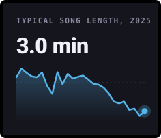
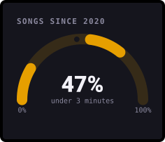
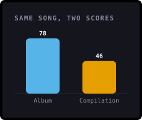
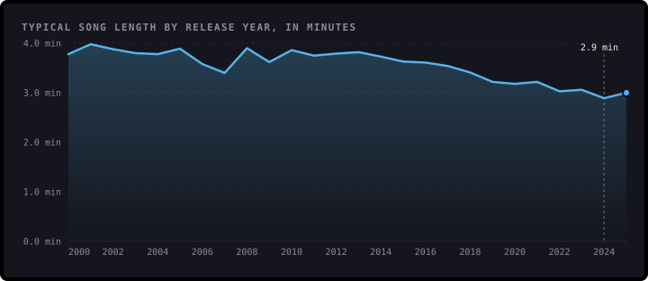
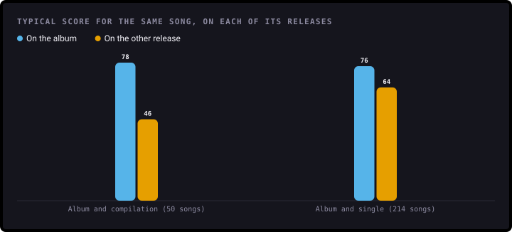
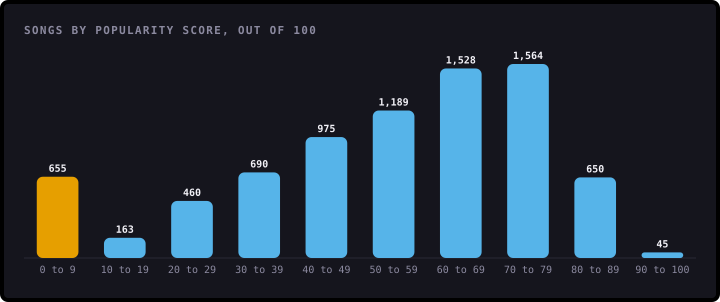
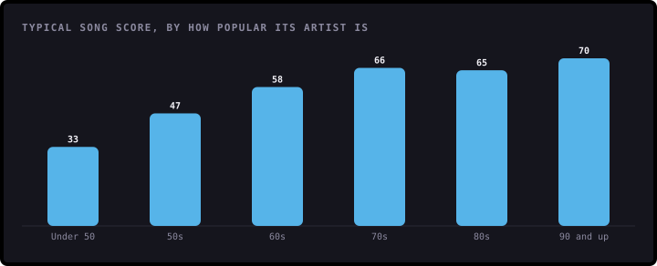

# Are Songs Getting Shorter?

**An analysis of 7,919 songs on Spotify, released from 1952 to 2025: how long they last, why the same song can score very differently, and what really goes with popularity.**

[](https://github.com/ShazMoghaddam/Spotify-Analysis/actions/workflows/checks.yml)
[](https://pypi.org/project/bezel-charts/)
[](LICENSE)

Spotify gives every track a popularity score from 0 to 100. This project looks at a sample of tracks collected from
Spotify in late 2025 to see what goes with a high score, and finds that the songs themselves have been getting shorter.

<p align="center">
  
  
  
</p>

> **Every chart here is drawn with [bezel-charts](https://pypi.org/project/bezel-charts/), an open-source Python library
> created by Shaz Moghaddam, the author of this project.** It turns pandas data into clean, self-contained SVG charts.

---

## Key findings

<!-- key-findings:start -->
### Songs are getting shorter

The typical song released from 2000 to 2009 lasts **3 minutes 44 seconds**. From 2020 to 2025 it's **3 minutes 2 seconds**. Nearly half of
recent songs (47%) are under 3 minutes, against 19% in the 2000s.



### The same song can score 78 or 46

Spotify scores every copy of a song separately. For 50 songs that are on both an album and a compilation, the
album copy typically scores **78** out of 100 and the compilation copy **46**.



### A score of zero doesn't mean nobody listens

442 songs score exactly 0, and 90 of them are by artists who score 70 or more, such as Bruno Mars's "Smokin Out The Window".
The first version called the scores "normal-like". They aren't.



### Big artists help, but they don't decide

Songs by the least popular artists typically score **33**, and songs by the most popular **70**. But how
popular the artist is explains only about **28%** of the differences between songs.


<!-- key-findings:end -->

**[Read all seven findings, and what the data can't tell you →](findings/README.md)**

| # | Finding | |
|---|---|---|
| 1 | Songs are getting shorter | Nearly half of recent songs are under 3 minutes |
| 2 | The same song can get very different scores | Album, single or compilation |
| 3 | A score of zero doesn't mean nobody listens | And the scores aren't a bell curve |
| 4 | Big artists help, but they don't decide | How much the artist explains |
| 5 | Length barely matters | Except for very short tracks |
| 6 | More songs are explicit, and they score higher | And it isn't just hip-hop |
| 7 | What the first version got wrong | Rows counted as popularity, and swapped axes |

---

## Run it yourself

You'll need Python 3.11 or newer. The data is small, so it's all in the repo.

```sh
git clone https://github.com/ShazMoghaddam/Spotify-Analysis.git
cd Spotify-Analysis
python3 -m venv .venv && source .venv/bin/activate
pip install -r requirements-dev.txt

python data/prepare.py      # tidy the data
python findings/build.py    # charts and report
pytest                      # checks the data and the numbers
```

Or open [`notebooks/spotify_analysis.ipynb`](notebooks/spotify_analysis.ipynb) for the same analysis with the working
shown.

## What's in the repo

```
├── data/
│   ├── raw/spotify_data_clean.csv   The Kaggle download, unchanged
│   ├── prepare.py                   Download to the tidy file below
│   ├── tracks.csv                   Every track, with one copy of each song marked to count
│   └── sources.json                 Where everything came from
├── findings/
│   ├── analysis.py                  Every calculation, as small functions
│   ├── charts.py                    Every chart
│   ├── build.py                     Writes the charts and the report
│   └── README.md                    The full report
├── notebooks/spotify_analysis.ipynb
├── charts/                          The SVG charts
├── tests/                           Checks on the data and the findings
└── .github/                         Automatic checks and dependency updates
```

## Data

The tracks come from the [Spotify Global Music Dataset (2009–2025) on Kaggle](https://www.kaggle.com/datasets/wardabilal/spotify-global-music-dataset-20092025),
collected from Spotify's public API and published under a public domain licence (CC0). Despite its name, its songs were
released from 1952 to 2025. [`data/sources.json`](data/sources.json) has the details.

Code and content in this repo are [MIT licensed](LICENSE). Spotify is a trademark of Spotify AB. This project isn't
connected with or endorsed by Spotify.

---

Created by **Shaz Moghaddam** · London
[Website](https://shazmoghaddam.github.io) · [LinkedIn](https://www.linkedin.com/in/shazmoghaddam)
