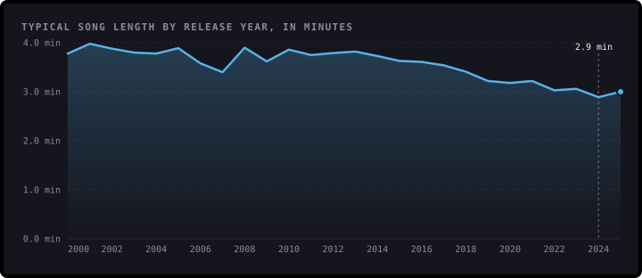
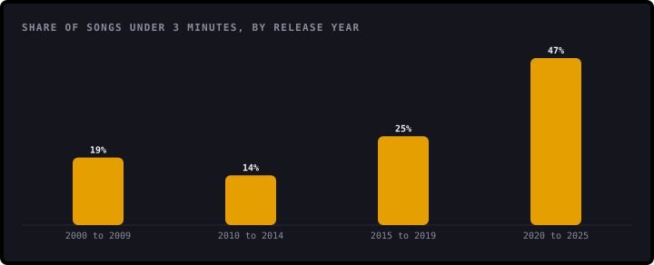
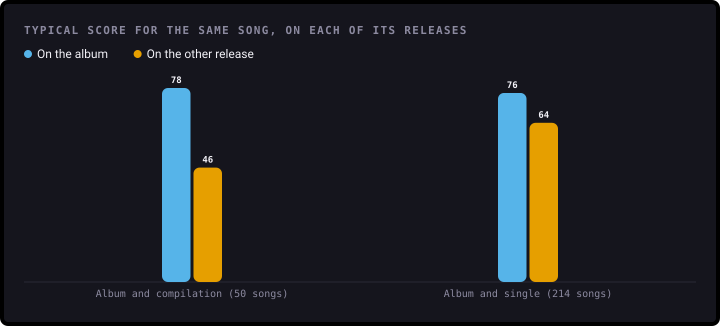
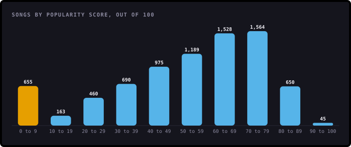
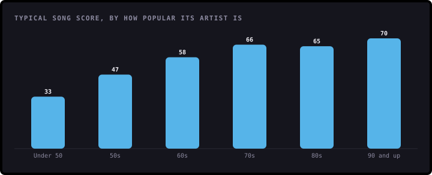
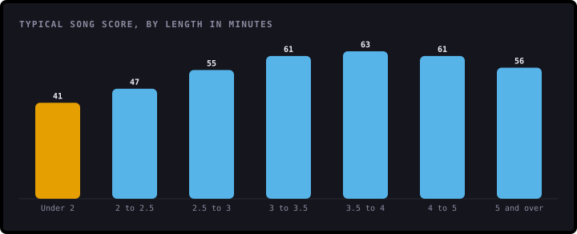
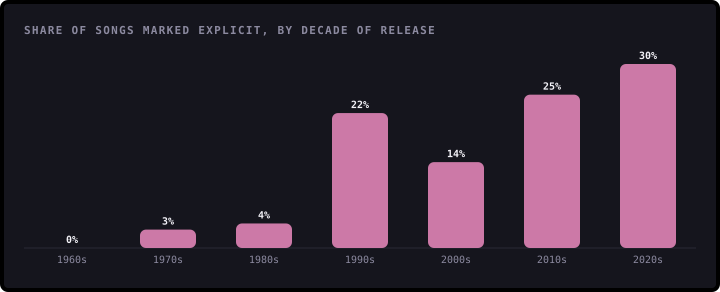
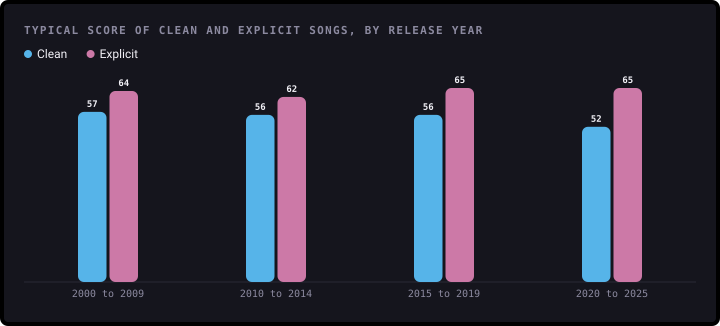
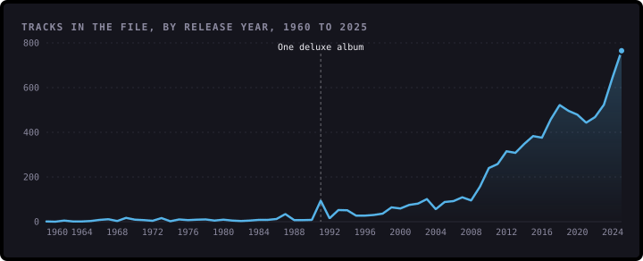

# Findings

What 7,919 songs on Spotify can and can't tell you. This page is written by [`build.py`](build.py), so every number comes
straight from the data.

The data is a sample of 8,581 tracks by 2,546 artists, released from 1952 to 2025. Many songs appear more than once,
for example on an album and again on a compilation, so most findings count each song once, using its most popular
copy. That leaves 7,919 songs.

**Popularity** is Spotify's own score, from 0 to 100. Spotify says it's based mostly on how many times a track has been
played and how recent those plays are. Each score here was read once, in late 2025, so it's a snapshot of what people
were listening to then, not a lifetime total.

## 1. Songs are getting shorter

The typical song released from 2000 to 2009 lasts 3 minutes 44 seconds (856 songs). From 2020 to 2025 it's
3 minutes 2 seconds (3,083 songs), 19% shorter. The shortest year is 2024, at 2 minutes 53 seconds.

The change is sharpest at the short end. 19% of songs from the 2000s are under 3 minutes, and 14% from 2010 to
2014. From 2020 to 2025 it's **47%**, nearly half.

Two checks make sure this isn't a quirk of which songs were collected. Counting only album tracks, the typical length
still falls, from 3 minutes 47 seconds to 3 minutes 13 seconds. Counting only songs that score 50 or more, it falls from
3 minutes 50 seconds to 3 minutes 9 seconds.

The data doesn't say why. Two reasons often given are that streaming counts a play the same however long the song is,
and that short songs suit short videos. Neither is measured here.

## 2. The same song can get very different scores

Spotify gives every copy of a song its own score. 580 songs appear more than once in the data, 1,242 copies in
all, and for 50% of them the best and worst copy are 20 or more points apart.

For example, 24kGoldn's "Mood" scores 77 on the album and 6 as a single. Plays tend to gather on one copy, and
the others are left with few.

The album copy usually wins. For the 50 songs on both an album and a compilation, the album copy scores
higher 86% of the time, typically 78 against 46. For the 214 songs on both an album and a single, it scores
higher 77% of the time, 76 against 64.5.

So a song's score depends on which copy you look at. Counting each song once, typical scores are 62 for album
tracks, 51 for singles and 43 for compilation tracks.

## 3. A score of zero doesn't mean nobody listens

442 songs (5.6%) score exactly 0. That's not because nobody has heard them. 90 are by artists who
score 70 or more, and the typical zero-scoring song is by an artist who scores 54. They include Taylor Swift's
"Blank Space - Voice Memo" and Bruno Mars's "Smokin Out The Window". The likely reason is the one in finding 2: plays are counted on another copy that
isn't in this sample.

The first version said popularity follows "a normal-like distribution". It doesn't. The most common scores are 60 to 79
(39% of songs), very few songs score 90 or more, and 8% score under 10, more than score 10 to 19.

## 4. Big artists help, but they don't decide

Every artist has a popularity score too. Songs by artists who score under 50 (1,303 songs) typically score 33.
Songs by artists who score 90 or more (758 songs) typically score 70.

The link is real but loose. The correlation is 0.52 (1 would be a perfect straight line), which means the artist's
score explains about 28% of the differences between songs. Even for the biggest artists, the middle half of their
songs score anywhere from 61 to 76, and 10% score under 50.

## 5. Length barely matters, except for very short tracks

Across all songs, the correlation between length and score is only 0.12. Leaving out tracks under 2 minutes, it's
0.06, which is no link at all. The first version was right about this.

The exception is the shortest tracks. The 433 tracks under 2 minutes typically score 41, against 63 for songs of
3.5 to 4 minutes. Many are intros, interludes and voice memos rather than full songs.

## 6. More songs are explicit, and explicit songs score higher

None of the songs from the 1950s and 1960s is marked explicit. 22% from the 1990s are, 14% from the 2000s, and
**30%** from the 2020s.

Explicit songs also score higher in every period: 64 against 57 for clean songs from 2000 to 2009, and
65 against 52 from 2020 to 2025. Comparing within each period means this isn't only because explicit songs
are newer.

Is the label just standing in for hip-hop and rap? Among the 5,221 tracks that have a genre, 59% of explicit
tracks are hip-hop or rap, against 9% of clean ones. But explicit tracks score higher on both sides: 65
against 58 within hip-hop and rap, and 65 against 55 for everything else. So genre doesn't explain it.

It's still a link, not a cause. The data can't say whether explicit lyrics draw listeners or something else does.

## 7. What the first version got wrong

- **Its top 10 artists counted rows, not popularity.** Nirvana came 5th with 91 tracks, but 70 of them are from one
  album, the *Nevermind (Super Deluxe Edition)*. Taylor Swift came first with 324 tracks from 38 different albums,
  including 43 from the "reputation Stadium Tour Surprise Song Playlist".
- **Its "music production" chart counted the sample, not the industry.** The number of tracks per year mostly rises
  because the sample favours recent music. The spike in 1991 is that same deluxe album: 70 of the year's 94 tracks.

- **Its scatter plot had its axes swapped.** The chart labelled "Artist Popularity" along the bottom was really showing
  track popularity, and the other way round.
- **It called popularity "normal-like".** See finding 3.
- **Its title said 2009 to 2025, and it promised audio features.** The songs go back to 1952, and the data has no
  audio features such as tempo or energy.

## What this data can't tell you

- **Whether music as a whole changed.** This is a sample of songs on Spotify in 2025, not every song ever released. Old
  songs are only here if they're still played, so earlier years are mostly hits. The checks in finding 1 help, but
  can't rule this out completely.
- **How popular a song has been over time.** Each score was read once, in late 2025, and Spotify weighs recent plays
  most. A song that was huge in 2005 can score lower than an average song from last month.
- **Why anything happened.** The data shows patterns, not causes.
- **Much about genre.** 39% of tracks have no genre, so genres are only used for one check in finding 6.

## About the data

The data was collected from Spotify's public API and published on Kaggle as the "Spotify Global Music Dataset
(2009–2025)", under a public domain licence (CC0). A few things needed fixing before it could be used:

- **662 rows repeat a song** already in the data, on another release. Each song is counted once in most findings,
  using its most popular copy. See [`data/prepare.py`](../data/prepare.py).
- **667 tracks are dated 1 January**, which usually means only the year was known. Only release years are used.
- **One row isn't music:** a four-second announcement credited to Spotify. It's removed.
- **3 tracks have no artist name.** They're kept, and each one only matches itself.
- **92% of songs were released in 2000 or later.** Years before that have too few songs for a fair typical
  figure, so findings over time start in 2000.

## How it was worked out

1. [`data/prepare.py`](../data/prepare.py) tidies the download, removes the announcement and marks one copy of each song to count.
2. [`analysis.py`](analysis.py) holds every calculation as a small, tested function.
3. [`charts.py`](charts.py) draws each chart with [bezel-charts](https://pypi.org/project/bezel-charts/).
4. [`notebooks/spotify_analysis.ipynb`](../notebooks/spotify_analysis.ipynb) walks through the same steps with the working shown.
